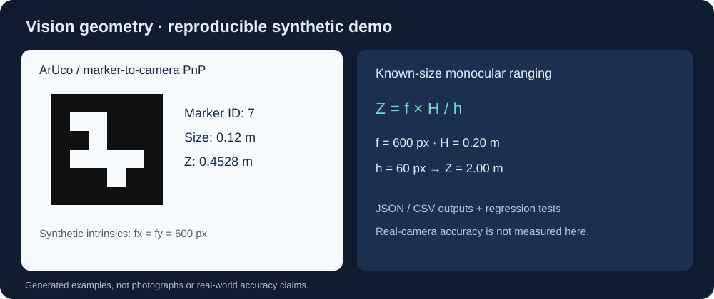

# Vision Geometry Toolkit · 视觉几何实验工具

把本地 **YOLO 单目估距** 与 **ArUco / PnP 位姿实验** 整理成可复现的命令行工具。
覆盖已知尺寸焦距校准、检测框估距、测量 CSV 评估、标记位姿和结果导出。

不依赖 ROS。默认演示不需要摄像头、模型权重或网络；真实 YOLO 推理按需安装。
这是学习实验与工程整理，不是通用单目深度模型，也没有宣称实测厘米级定位精度。



> 图和示例报告均为程序生成的合成数据，用于检查数学与接口；不代表真实相机性能。

## 安装与快速体验

Python 3.10+，建议在独立虚拟环境中使用。Ubuntu 如缺少 venv，可先安装 `python3-venv`。

```bash
git clone https://github.com/addrun/vision-geometry-toolkit.git
cd vision-geometry-toolkit
python3 -m venv .venv
source .venv/bin/activate
pip install -e '.[test]'
vision-geometry demo --output output/demo
python -m pytest -q
```

输出包括 `aruco_input.png`、`aruco_pose.png`、`ranging.csv` 和 `report.json`。
已提交的文本结果见 [examples/results](examples/results)，便于无需运行即可检查。

## 1. 已知尺寸单目估距

假设目标近似正对相机、实际高度已知、检测框完整且校准后图像缩放不变：

```text
焦距 f_px = 像素高度 h_px × 已知距离 Z_m / 实际高度 H_m
距离 Z_m = f_px × H_m / h_px
```

这里的距离近似为沿光轴的距离；目标倾斜、尺寸差异、遮挡、截断和框抖动都会影响结果。
单点尺寸校准不会估计完整相机内参或畸变。

```bash
vision-geometry calibrate --pixel-height 120 --real-height-m 0.2 \
  --distance-m 1.0 --label bottle --output output/ranging.json
vision-geometry range --config output/ranging.json --label bottle --pixel-height 60
# 2.000000 m
```

所有实际长度统一使用米，焦距和框高度使用像素；配置保存为可读 JSON。
示例配置里的物体高度只是先验值，使用前应换成实际被测目标尺寸。

用独立测量的数据检查效果：

```bash
vision-geometry evaluate --config configs/ranging.example.json \
  --csv examples/synthetic_measurements.csv --output output/evaluation.json
```

CSV 字段为 `label,pixel_height,distance_m`。示例 CSV 是合成数据；
实际评估时使用未参与校准的距离和真实测量值，输出逐样本误差与 MAE。

### 可选 YOLO 检测

```bash
pip install -e '.[yolo]'
vision-geometry detect --source /absolute/path/to/video.mp4 \
  --model /absolute/path/to/yolo11n.pt --config output/ranging.json \
  --max-frames 100 --output output/detection
```

`--source 0` 使用摄像头；`--show` 开启窗口。默认无 GUI，按帧保存图片与 JSON。
权重必须是现有本地文件，命令不会自动下载权重。未知尺寸类别、图像边缘被截断的框不输出距离。
YOLO 是上游检测器，本项目负责估距、输入校验和结果组织。

## 2. ArUco 标记到相机的位姿

```bash
vision-geometry aruco --image output/demo/aruco_input.png \
  --camera configs/camera.synthetic.json --marker-size-m 0.12 \
  --dictionary DICT_4X4_50 --output output/aruco
```

真实图像必须使用对应分辨率的相机标定。`camera.synthetic.json` 仅适用于合成演示。
输入图像尺寸与标定尺寸不符会直接报错，避免悄悄使用错误内参。

输出 `annotated.png` 和 `poses.json`，每个标记包含：

- `translation_m` 与 `rotation_vector_rad`：**标记坐标到相机坐标**的变换，满足 `P_camera = R * P_marker + t`。
- `camera_position_in_marker_m`：通过 `-Rᵀt` 得到的相机原点在标记坐标系中的位置。
- `reprojection_rmse_px`：四角点重投影 RMSE。它不是空间定位误差，也不能单独排除平面位姿歧义。

相机坐标采用 OpenCV 光学约定：X 向右、Y 向下、Z 向前。
标记原点在中心，X 向右、Y 向上。单标记 PnP 的稳定性仍受分辨率、角度、畸变和标记打印尺寸影响。

## 项目组织与验证

```text
src/vision_geometry/   尺寸几何、ArUco、CLI 与合成演示
configs/               标定与尺寸配置示例
examples/              合成测量 CSV 和已运行的文本结果
tests/                 单位、异常输入和合成标记回归
```

本机验证范围与版本见 [docs/VALIDATION.md](docs/VALIDATION.md)。
CI 运行几何测试和无模型演示，不将其作为真实相机或 YOLO 精度验收。
来源、原实验与发布整理的边界见 [NOTICE.md](NOTICE.md)。本仓库采用 AGPL-3.0-only。
